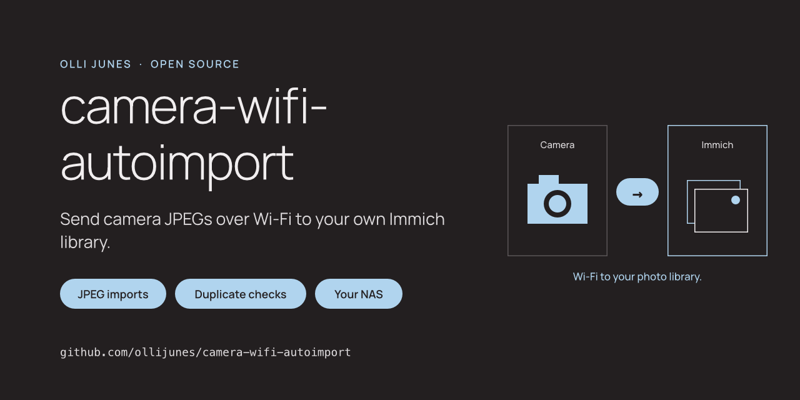
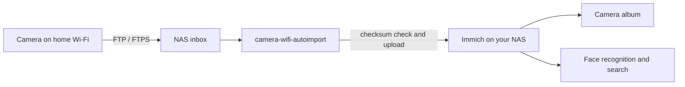

# camera-wifi-autoimport



[](https://github.com/ollijunes/camera-wifi-autoimport/actions/workflows/ci.yml)
[](pyproject.toml)
[](LICENSE)

**Get your camera's photos into Immich over your home Wi-Fi.**

Your camera sends JPEGs to a folder on your NAS. This script imports them into
Immich, checks for exact duplicates, and adds them to an album. Immich then runs
its own thumbnail, face recognition and search jobs.

The project grew out of a Sony A7 IV and Synology setup. The importer does not
depend on a camera brand: it reads a folder, so another camera or transfer tool
can feed it too. **Wi-Fi alone is not enough.** The camera needs FTP/FTPS upload,
or a separate tool that saves complete JPEGs to that folder.

[Synology setup](docs/synology.md) · [Camera compatibility](docs/cameras.md) ·
[Troubleshooting](docs/troubleshooting.md) · [Security](SECURITY.md) ·
[Contributing](CONTRIBUTING.md)

Read the project story: [English](https://ollijunes.com/camera-wifi-autoimport-sony-immich/)
· [Suomeksi](https://ollijunes.com/fi/kameran-kuvat-wifi-immich/).



## What it does

- Imports `.jpg` and `.jpeg` files from an inbox and its subfolders.
- Waits for unchanged size, modification time and filesystem change time across
  two runs, then checks JPEG start/end markers and takes a private snapshot.
- Uses Immich's SHA-1 duplicate check. An identical file with a different name
  can be added to the album without uploading the photo again.
- Adds both new uploads and existing duplicates to your chosen album.
- Retries unfinished work on the next scheduled run, including album failures
  after a successful upload.
- Reports a file that can never pass (over the size limit, missing JPEG markers,
  rejected by Immich as unsupported) once, then counts it as `rejected` until the
  file itself changes.
- Keeps source files in place. There is no delete, move, purge or camera-card
  cleanup command.

It is a single Python script with no runtime dependencies outside the standard
library. Python 3.11 or later, **Immich 3.0 or later** and a POSIX host (Linux,
Synology or macOS) are required. Windows is not supported by this release.

## Quick start

For a full camera-to-NAS setup, follow the [Synology guide](docs/synology.md).
If you already have a JPEG inbox and Immich running:

```sh
git clone https://github.com/ollijunes/camera-wifi-autoimport.git
cd camera-wifi-autoimport
python3 --version
```

1. In Immich, create an API key for the account that should own the photos.
   Grant `asset.upload`, `album.read`, `album.create` and `albumAsset.create`.
2. Store it in a file **outside this checkout and outside the camera inbox**.
   Give the file mode `600`; the script reads the key from the file, never from
   a command-line argument. The [setup guide](docs/synology.md#4-configure-the-importer)
   includes a hidden-input command.
3. Copy [config.example.toml](config.example.toml) to a private location and edit
   the server URL, inbox, key path, state directory and album name. Use absolute
   paths. Create the state directory with mode `700` under the importer user's account.
4. Run a dry run, wait at least `settle_seconds`, and run it again:

```sh
python3 camera_import.py --config /path/to/private/config.toml --dry-run
```

The first run records observations. The second can report `would_upload` or
`would_duplicate`. Dry run changes local observation state and contacts Immich's
duplicate-check endpoint, but does not upload photos or change albums.

5. Import the photos:

```sh
python3 camera_import.py --config /path/to/private/config.toml
```

Open the album in Immich and check the photo, capture time and image resolution.
Then [schedule the command every two minutes](docs/synology.md#5-schedule-it).
The command makes one pass and exits; it does not run a background service.

## Compatibility and verification

| Component | Status |
| --- | --- |
| Sony A7 IV → Synology FTP inbox → Immich | Used with the original private workflow that this project replaces |
| This public importer | Automated unit and local HTTP protocol tests; not yet validated end to end on a physical camera/NAS |
| Immich API | Requests checked against the published **v3.3.1** OpenAPI schema; no live Immich instance is started by the test suite. Immich 2.x and older require `deviceAssetId`/`deviceId` on upload and answer HTTP 400 |
| Nikon / Canon / other cameras | Folder-based ingestion is brand independent; model-specific FTP support must be checked, and these cameras have not been tested here |
| JPEG | Supported; marker checks catch common interrupted transfers, not every form of image corruption |
| RAW, HEIF, video, sidecars | Left untouched; not imported in this release |

See [camera requirements and manufacturer links](docs/cameras.md).
Do not interpret the repository name as a promise that every Wi-Fi camera can
transfer files without its manufacturer's app.

## How retries and duplicates work

The local SQLite state records a file only after Immich confirms its asset and
album membership. If an upload succeeds but its response is lost, a later run
checks the checksum again and can finish using the existing asset.

Duplicate means the same file bytes, using Immich's checksum. It does not mean
similar-looking frames, resized exports, or RAW/JPEG pairs. Files already in
Immich's trash are held for manual review, not automatically restored; they are
retried on every run because the trash state can change in Immich.

A file that fails a local check (size limit, JPEG markers) or that Immich rejects
as unsupported is reported once with exit code `1`. Later runs count it as
`rejected` and exit `0`, so a scheduler alert fires once, not every two minutes.
Replace or retransmit the file to trigger a fresh check; the importer never
deletes it for you.

State is bound to the server URL, inbox, album selection and API key. If you
change one of these, choose a new empty `state_dir`. The next runs recheck the
inbox against Immich. An unchanged completed file is skipped locally, so this
is **not** a continuous repair of albums or assets deleted later in Immich.

Use one scheduler per inbox and state directory. A lock prevents overlapping
runs using the same state directory. Multiple runners with different state
directories can still race to create an album; preselect an `album_id` if you
deliberately run several independent inboxes into the same album.

## Privacy and storage

Photos go to the Immich server you configure. There is no analytics, cloud
relay or external face-recognition service in this script. Your Immich
deployment determines where its machine-learning jobs run.

The inbox retains its JPEGs, and Immich stores its own copy. Plan for both.
The script never writes directly into Immich's managed upload/library folders.
Do not also register the inbox as an external library: that is a separate
ingestion path and can produce duplicate entries.

Face analysis runs after import according to your Immich settings. Successful
import does not mean those jobs are finished, and it is not a backup check.
Back up both the photo storage and Immich database separately.

Normal logs contain counts and fixed error messages, without filenames, keys,
server URLs or server error bodies. Private state contains local filenames;
temporary snapshots contain photo bytes and are created in the private state
directory. See the [security model and limits](SECURITY.md).

## FAQ

**Will photos transfer when I get home?**
Only if your camera supports the required transfer behavior, reconnects to your
home Wi-Fi, and is powered in a state that permits transfer. Previously shot
photos may need to be selected for FTP transfer. Check your model's manual.

**Can I use another NAS or a Linux server?**
Yes, if it can receive the JPEGs and run Python 3.11+ with a private state
directory on a local filesystem. The detailed receiver instructions cover DSM.

**Can each camera have its own album?**
Use one inbox, private configuration and state directory per camera. Give each
configuration its album name or explicit album UUID. No EXIF-brand filter is
required. Existing photos elsewhere in Immich are not swept into albums.

**Does it need a GPU?**
The importer does not. Immich handles machine learning separately; see its
[remote machine-learning guide](https://docs.immich.app/guides/remote-machine-learning/)
if you want to use another machine.

## Development

```sh
uv sync --locked
uv run python -m pytest --cov=camera_import --cov-fail-under=85
uv run ruff check .
uv run ruff format --check .
```

Tests use generated marker fixtures, temporary directories and a local HTTP
server, not personal photographs or real API credentials. CI also scans Git
history with Gitleaks. See [CONTRIBUTING.md](CONTRIBUTING.md) before sending logs
or compatibility reports.

## License

[MIT](LICENSE). This is an independent project, not an official Sony, Nikon,
Canon, Synology or Immich integration.
